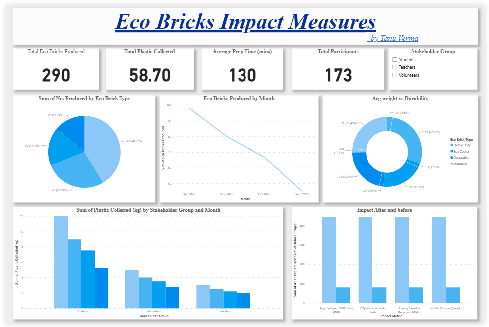

# Eco Bricks Impact Measures Dashboard (Power BI)

An interactive **Power BI** sustainability and environmental impact dashboard tracking plastic waste collection, eco-brick production across brick categories, stakeholder participation, and before-vs-after environmental benchmarks.

## 📊 Key Metrics & KPIs (Overall Project)
* **Total Eco Bricks Produced:** 290 units
* **Total Plastic Waste Diverted:** 58.70 kg
* **Total Participants:** 173 contributors across *Students*, *Teachers*, and *Volunteers*
* **Stakeholder Breakdown (Filtered View Example – Teachers):** 55 eco-bricks produced, 9.70 kg plastic collected, and 12 active participants

## 💡 Key Project Insights
* **Production by Brick Type:** **Heavy Duty** and **Eco Cooler** bricks account for the largest share of overall production, alongside **Decorative** and **Standard** variants.
* **Monthly Production Trend:** Eco-brick output grew steadily from **September 2025 through December 2025** as awareness and collection drives scaled up.
* **Stakeholder Contribution:** **Students** contributed the highest volume of collected plastic waste, supported by **Teachers** and **Volunteers** across all four months.
* **Environmental & Cost Impact:** Comparing **Before Project** vs. **After Project** benchmarks highlights measurable improvements across **Avg. Cost per 1,000 bricks (INR)**, **CO₂ Emissions per kg of plastic**, **Energy Saved in Recycling (MJ/kg)**, and **Landfill Volume (liters/kg)**.

## 🛠️ Tools & Data Modeling
* **Power BI Desktop:** Built interactive KPI cards, donut charts, monthly trend line charts, clustered column comparisons, and stakeholder slicers.
* **Multi-Table Data Model:** Integrated *Eco Brick Types*, *Participation*, *Education & Awareness*, *Impact Benchmarks*, and *National Data* tables into a unified analytical report.

## 📁 Repository Folder Contents
* `eco_bricks_impact_dashboard.pbix` – Interactive Power BI Desktop report file
* `eco_bricks_type.xlsx` – Source project and environmental benchmark data
* `education and awareness.xlsx` – Source project and environmental benchmark data
* `eco bricks participants.xlsx` – Source project and environmental benchmark data
* `National data of plastic waste.xlsx` – Source project and environmental benchmark data
* `eco bricks Impact Benchmarks.xlsx` – Source project and environmental benchmark data
* `eco_bricks_dashboard_preview.png` – High-resolution report preview
* `README.md` – Project documentation and key findings
