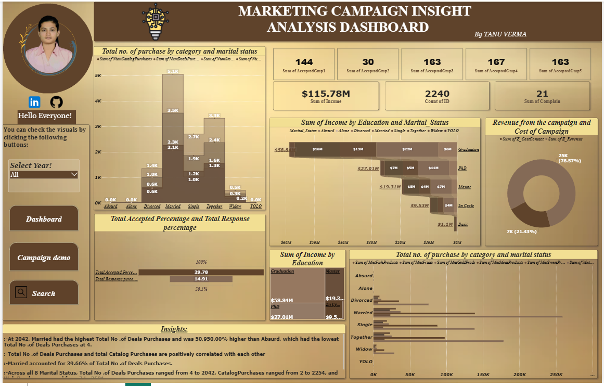

# Marketing Campaign Insight Analysis Dashboard (Power BI)

An interactive **Power BI** customer and campaign analytics dashboard evaluating marketing campaign acceptance rates across Campaigns 1–5, customer demographics, income distribution, and multi-channel purchasing behavior.

## 🎯 Executive Summary (At a Glance)

| Metric / Focus Area | Key Finding |
| :--- | :--- |
| **Total Customer Base** | **2,240 customers** analyzed across education and marital segments |
| **Cumulative Customer Income** | **$115.78M** total reported household income |
| **Top-Performing Campaign** | **Campaign 4** achieved the highest acceptance with **167 responses** |
| **Campaign Revenue vs. Cost** | **78.57% ($26K)** campaign revenue vs. **21.43% ($7K)** campaign cost |

## 📊 Campaign Acceptance Breakdown
* **Campaign 1:** 144 accepted
* **Campaign 2:** 30 accepted
* **Campaign 3:** 163 accepted
* **Campaign 4:** 167 accepted *(Highest performing)*
* **Campaign 5:** 163 accepted
* **Customer Complaints:** 21 recorded

## 💡 Key Business Insights
* **Top-Performing Customer Segment:** **Married** customers represent the largest purchasing group, accounting for **39.66%** of total deal purchases (`2,042` deals) and leading across store, web, and catalog channels.
* **Education & Income Distribution:** **Graduation**-level customers generate the highest cumulative income (**$58.84M**) across marital segments, followed by **PhD** (**$27.01M**) and **Master's** degree holders.
* **Channel Correlation:** Deal purchases and catalog purchases show a strong positive correlation across customer segments, ranging from 2 to 2,254 catalog purchases.

## 🛠️ Tools & Features Used
* **Power BI Desktop:** Interactive year slicers, custom navigation buttons (*Dashboard*, *Campaign Demo*, *Search*), KPI cards, stacked bar/column charts, funnel chart, and donut visuals.
* **Author:** Analysis and dashboard design by **Tanu Verma**.

## 📁 Repository Folder Contents
* `Marketing_campaign_insight_analysis_Dashboard.pbix` – Interactive Power BI Desktop report file
* `marketing_campaign.csv` – Source customer demographics and campaign dataset
* `marketing_campaign_dashboard_preview.png` – High-resolution report preview
* `README.md` – Project documentation and analytical insights
