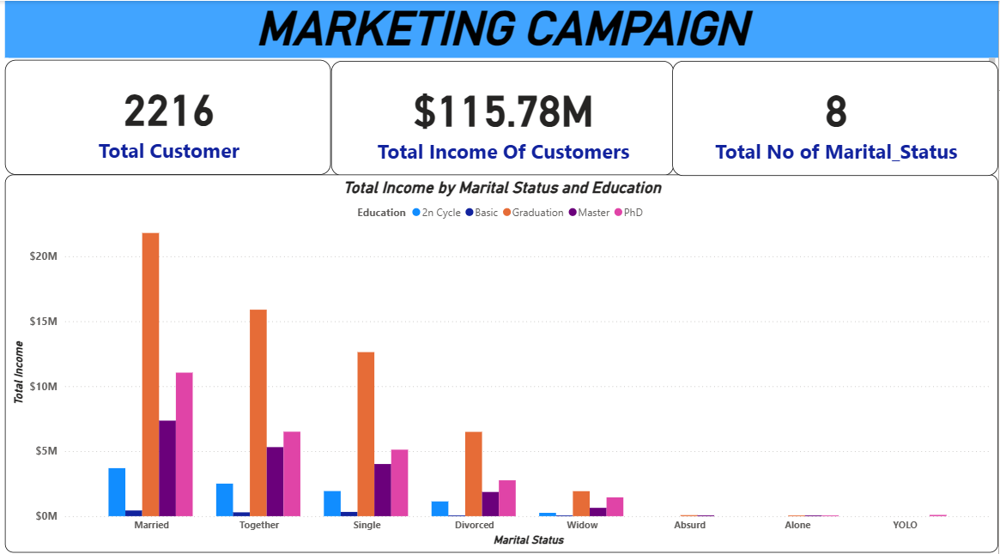
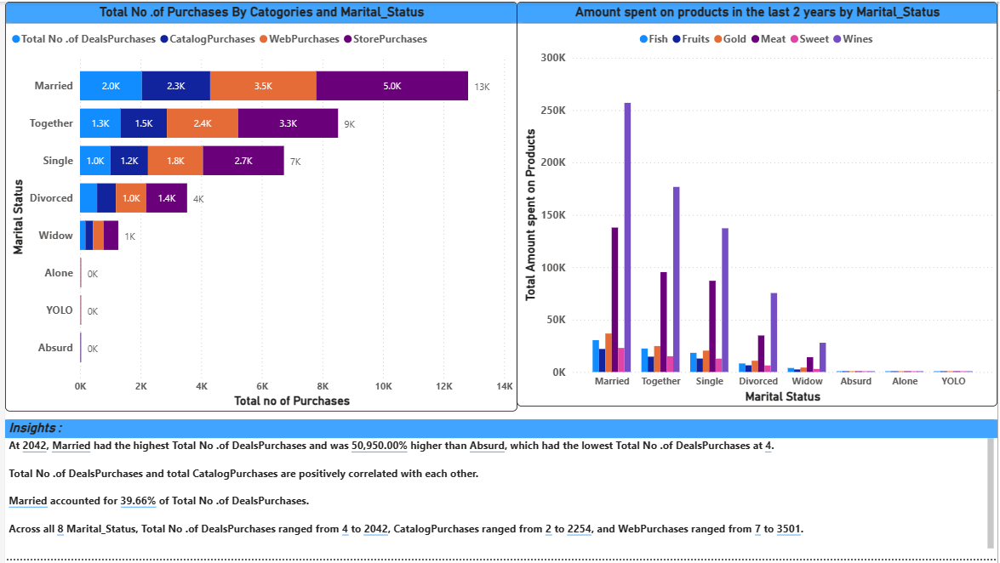
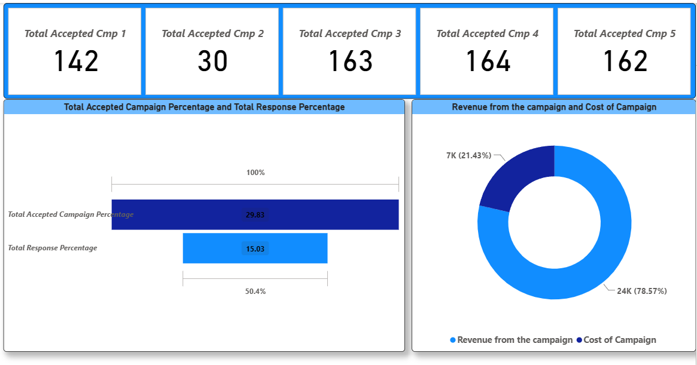

# Marketing Campaign Multi-Page Analysis (Power BI)

An interactive 3-page **Power BI** customer segmentation and campaign performance dashboard analyzing customer income distribution, multi-channel purchasing behavior, product category spending, and campaign ROI.

## 📑 Page-by-Page Breakdown

### 1. Customer & Income Overview

* **Customer Base & Income:** Tracks **2,216 total customers** generating **$115.78M** in cumulative income across **8 marital segments**.
* **Education & Income:** **Graduation**-level customers lead total income across every marital category, followed by **PhD** and **Master's** degree holders.

### 2. Purchasing Channels & Product Spending

* **Channel Dominance:** **Married** customers lead all purchasing channels (`13K` total purchases), accounting for **39.66%** (`2,042`) of deal purchases, **5.0K** store purchases, and **3.5K** web purchases.
* **Product Category Spending:** **Wines** and **Meat** generate the highest spending over the last 2 years across all marital groups.

### 3. Campaign Acceptance & ROI Performance

* **Campaign Acceptance Counts:** **Campaign 4** achieved the highest acceptance (**164**), followed closely by **Campaign 3 (163)** and **Campaign 5 (162)**, while **Campaign 2** had the lowest (**30**).
* **Conversion & ROI:** Overall accepted campaign rate reached **29.83%** (`15.03%` total response rate), generating **24K (78.57%)** in campaign revenue against **7K (21.43%)** in campaign costs.

## 📁 Repository Folder Contents
* `Multipage_Marketing_campaign_Dashboard.pbix` – Interactive 3-page Power BI Desktop report file
* `marketing_campaign_data.csv` – Source customer and campaign dataset
* `01_customer_overview.png` – Page 1 customer and income distribution preview
* `02_purchasing_spending.png` – Page 2 channel and product spending preview
* `03_campaign_performance.png` – Page 3 campaign acceptance and ROI preview
* `README.md` – Project documentation and key findings
