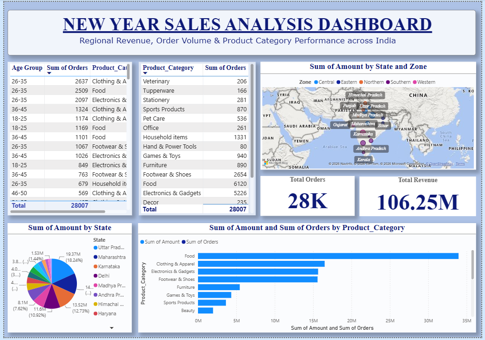

# New Year Sales Analysis Dashboard (Power BI)

An interactive **Power BI** sales performance dashboard analyzing customer orders, demographic buying patterns, regional revenue across Indian states and zones, and top-performing product categories during the New Year shopping season.

## 📊 Key Metrics & KPIs
* **Total Revenue:** ₹106.25M
* **Total Orders:** 28K (28,007 total orders)
* **Geographic Scope:** 5 Regional Zones (*Central, Eastern, Northern, Southern, Western*) across Indian states

## 💡 Key Business Insights
* **Top-Performing States:** **Uttar Pradesh** leads revenue generation at **₹19.37M (18.24%)**, followed by **Maharashtra** at **₹13.52M (12.73%)**, **Karnataka** at **₹11.6M (10.92%)**, and **Delhi** at **₹8.1M (7.62%)**.
* **Leading Product Categories:** **Food** dominates overall sales revenue (~₹34M) and order volume (**6,120 orders**), followed by **Clothing & Apparel**, **Electronics & Gadgets** (**5,226 orders**), and **Footwear & Shoes** (**2,654 orders**).
* **Primary Customer Demographic:** Customers in the **26–35 age group** generate the highest order volumes across top categories, led by **Clothing & Apparel (2,637 orders)**, **Food (2,509 orders)**, and **Electronics & Gadgets (2,097 orders)**.

## 🛠️ Tools & Data Preparation
* **Power BI Desktop:** Designed multi-visual executive layout featuring KPI cards, an interactive Bing Map, donut chart, stacked bar chart, and summary tables.
* **Power Query:** Standardized text fields (`Trim`) to eliminate duplicate category entries and configured geographic data categories (`State or Province`) for accurate regional mapping across India.

## 📁 Files in This Folder
* `new_year_sales_dashboard.pbix` – Interactive Power BI report file
* `New Year Sales Data.csv` – Source sales dataset
* `new_year_sales_dashboard_preview` – Full-screen preview of the report
