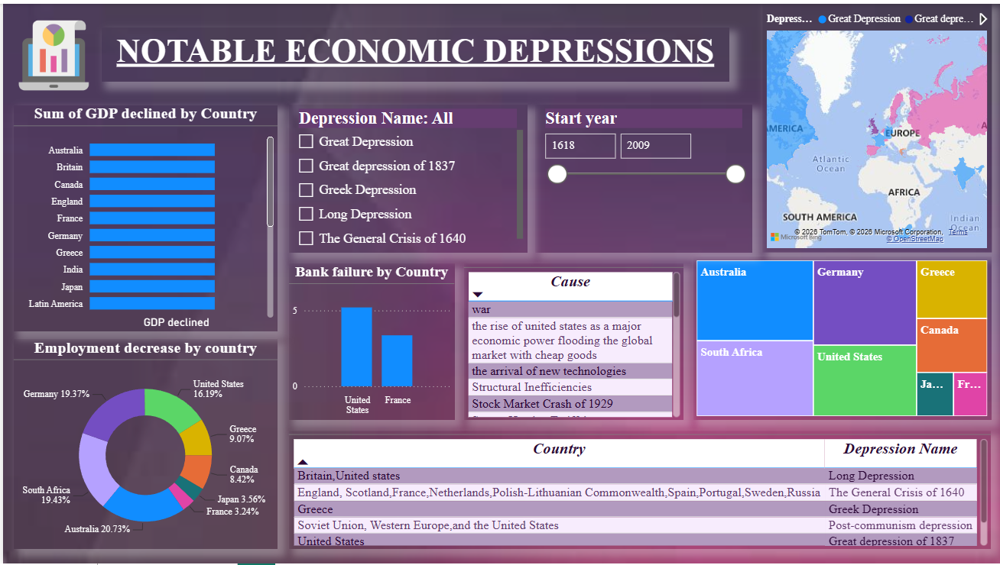

# Notable Economic Depressions Analysis Dashboard (Power BI)

An interactive **Power BI** historical economics dashboard analyzing major global economic depressions from **1618 to 2009**, exploring GDP decline, bank failure rates, employment decreases, affected regions, and primary economic triggers.

## 📊 Key Insights & Dashboard Visuals
* **Employment Decrease by Country:** **Australia (20.73%)**, **South Africa (19.43%)**, and **Germany (19.37%)** experienced the highest relative employment contractions, followed by the **United States (16.19%)**, **Greece (9.07%)**, and **Canada (8.42%)**.
* **Bank Failure Impact:** Highlights severe banking sector distress led by the **United States** and **France** during major financial downturns.
* **Interactive Timeline & Event Filtering:** Filter historical downturns spanning **1618–2009** using the **Start Year** slider and **Depression Name** checklist (*The General Crisis of 1640*, *Great Depression of 1837*, *Long Depression*, *Great Depression*, *Greek Depression*, and *Post-Communism Depression*).
* **Geographic & Root Cause Analysis:** Maps affected countries globally via an interactive Bing Map and treemap while cataloging core triggers such as **war**, **stock market crashes (1929)**, **structural inefficiencies**, and **rapid technological shifts**.

## 🛠️ Tools & Features Used
* **Power BI Desktop:** Interactive Bing Map, treemap, horizontal bar chart, column chart, donut visual, summary table, and multi-select slicers.
* **Author:** Analysis and dashboard design by **Tanu Verma**.

## 📁 Repository Folder Contents
* `notable_economic_depressions.pbix` – Interactive Power BI Desktop report file
* `Notable Economic depressions.xlsx` – Source historical economic dataset (`1618–2009`)
* `Notable Economic depression1.xlsx` – Source historical economic dataset (`1618–2009`)
* `economic_depression_preview.png` – High-resolution report preview
* `README.md` – Project documentation and analytical insights
