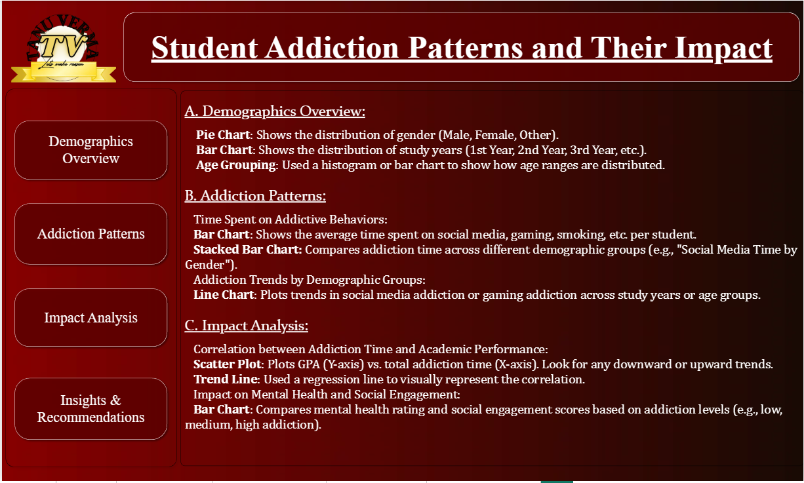
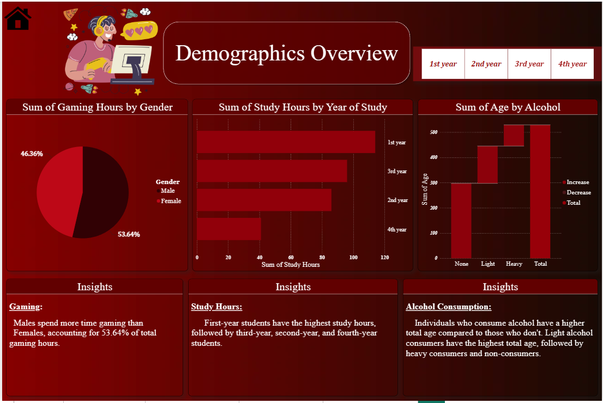
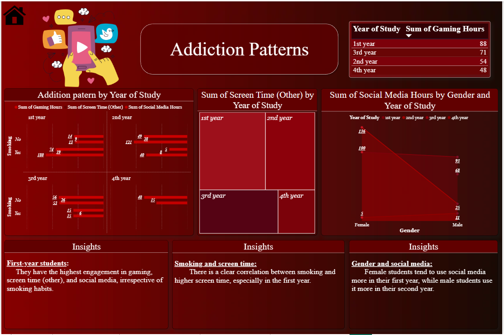
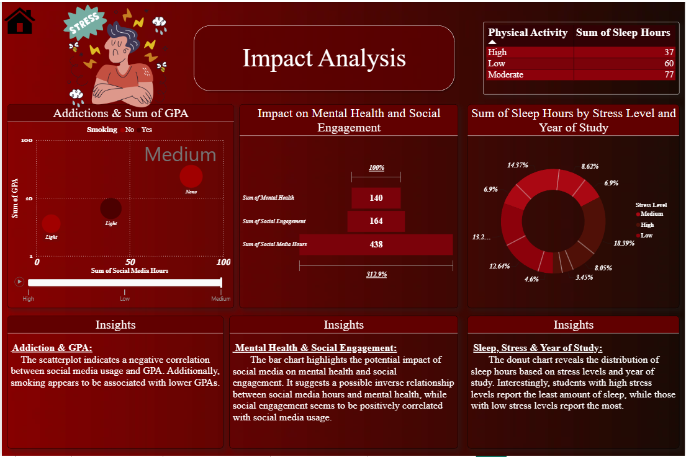
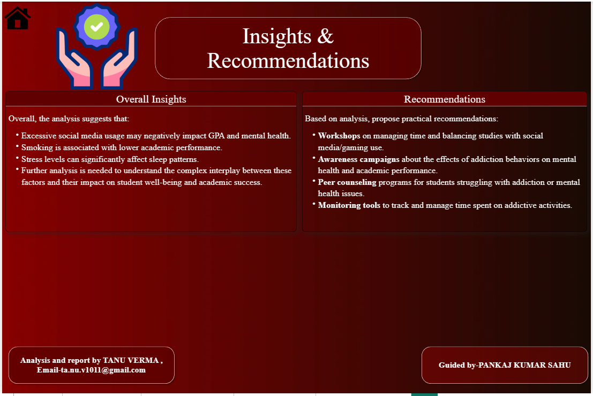

# Student Addiction Patterns and Their Impact (Power BI)

An interactive 5-page **Power BI** behavioral and academic analytics report exploring student screen time, gaming, social media usage, lifestyle habits, and their correlation with GPA, sleep, and mental health.

## 🎯 Executive Summary (At a Glance)

| Focus Area | Key Metric / Finding |
| :--- | :--- |
| **Gaming Habits** | Male students account for **53.64%** of total gaming hours vs. **46.36%** for females. |
| **Highest Risk Group** | **1st-year students** show the highest combined engagement across gaming (**88 hrs**) and social media. |
| **Academic Impact** | High social media usage and smoking show a **negative correlation with GPA**. |
| **Health & Sleep** | Moderate physical activity yields the highest sleep (**77 hrs**), while high stress sharply reduces sleep. |

## 📑 Report Navigation & Page Breakdown

### 1. Demographics Overview

* **Gaming Distribution:** Male students account for **53.64%** of total gaming hours compared to **46.36%** for female students.
* **Study Hours by Year:** **1st-year students** log the highest total study hours, followed by 3rd-year, 2nd-year, and 4th-year students.
* **Alcohol Consumption by Age:** Light and heavy alcohol consumers skew higher in cumulative age compared to non-consumers.

### 2. Addiction Patterns

* **First-Year Engagement:** 1st-year students record the highest combined engagement across gaming (`88 hrs`), social media, and other screen activities.
* **Gender & Social Media:** Female students show higher social media usage during their 1st year, while male usage peaks in the 2nd year.
* **Smoking & Screen Time:** Higher screen time correlates noticeably with smoking habits, particularly among 1st-year students.

### 3. Impact Analysis

* **Academic Performance (GPA):** Scatter plot analysis shows a negative correlation between high social media/smoking habits and student GPA.
* **Mental Health & Social Engagement:** Higher social media hours correspond with lower mental health scores, alongside moderate physical activity yielding the highest sleep hours (`77 hrs`).
* **Sleep & Stress Levels:** Students reporting high stress levels experience the lowest share of sleep hours.

### 4. Insights & Recommendations

* **Actionable Interventions:** Proposes campus time-management workshops, mental health awareness campaigns, peer counseling programs, and digital screen-time tracking tools.

## 🛠️ Tools & Features Used
* **Power BI Desktop:** Multi-page navigation buttons, interactive slicers, scatter plots with trend analysis, ribbon charts, waterfall charts, and donut visuals.
* **Guided Project:** Analysis and report by **Tanu Verma** (Guided by **Pankaj Kumar Sahu**).

## 📁 Repository Folder Contents
* `Student_Addiction_Analysis_Dashboard.pbix` – Interactive 5-page Power BI Desktop report file
* `Social media age ,year,etc dataset.csv` – Source student lifestyle, screen time, and academic performance dataset
* `01_overview.png` – Home page & report navigation overview
* `02_demographics.png` – Student demographics, gaming hours, and study hours preview
* `03_addiction_patterns.png` – Screen time, social media, and smoking trends preview
* `04_impact_analysis.png` – GPA correlation, mental health, and sleep analysis preview
* `05_recommendations.png` – Key findings and actionable recommendations preview
* `README.md` – Project documentation and analytical insights
